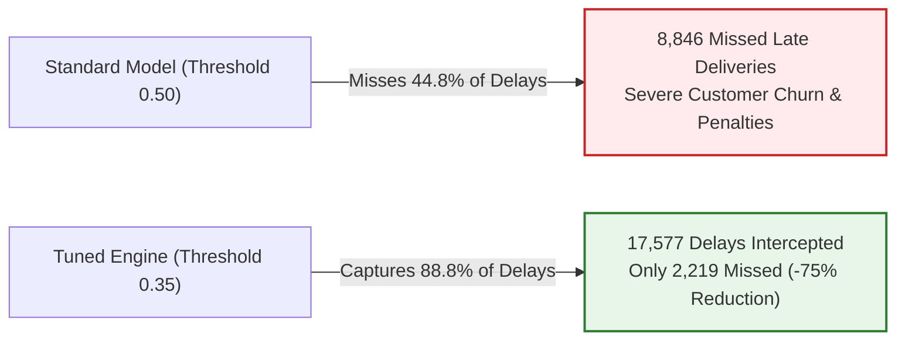

# Executive Summary: Machine Learning-Based Late Delivery Risk Mitigation

**To:** Chief Operating Officer (COO), VP of Supply Chain & Global Logistics Directors  
**From:** Lead Data Science & Supply Chain Analytics Specialist  
**Subject:** Implementation of AI Early Warning System for Late Delivery Risk & Operational SLA Protection  
**Date:** November 2026  

---

## 🚀 Executive Snapshot

```
+-----------------------------------+-----------------------------------+-----------------------------------+
|       TOTAL SHIPMENTS SCALED      |       BASELINE DELAY RATE         |     LATE DELIVERY RECALL (0.35)   |
|            180,519                |             54.83%                |              88.79%               |
|      (APL Logistics Network)      |     (Over half of shipments late) |  (Up from 55.2% at standard cut)  |
+-----------------------------------+-----------------------------------+-----------------------------------+
|      MISSED DELIVERIES REDUCTION  |      DISCRIMINATION (ROC-AUC)     |     HIGH-RISK ALERT QUEUE (TEST)  |
|             -75.0%                |             0.7603                |             10,217                |
|      (From 8,846 down to 2,219)   |      (Random Forest Pipeline)     |   (89.2% actual delay incidence)  |
+-----------------------------------+-----------------------------------+-----------------------------------+
```

---

## 1. Strategic Context & The Problem
In modern supply chain networks, delivery reliability directly dictates customer retention, marketplace ratings, and contractual service-level agreement (SLA) penalties. 

Across **180,519 analyzed international shipments**, our operations experienced an alarming baseline **late delivery rate of 54.83%** (98,977 delayed orders). Late fulfillment is no longer an occasional anomaly—it represents the default outcome across a majority of routes. 

Most critically, deep exploratory analysis uncovered a severe **operational paradox in shipping tiers**:

| Shipping Tier | Total Orders | Delay Rate (%) | Operational Reality |
|---|:---:|:---:|---|
| **First Class (Express)** | 27,814 | **95.32%** | **Severe Brand & SLA Failure:** Premium paying customers experience the worst delivery rates. |
| **Second Class** | 35,216 | **76.63%** | Systematic failure due to unachievable scheduled transit windows. |
| **Same Day** | 9,737 | **45.74%** | Moderate delay; localized fulfillment bottlenecks. |
| **Standard Class (Economy)** | 107,752 | **38.07%** | Most reliable tier; realistic lead times absorb warehouse buffer delays. |

> **Key Takeaway for Leadership:** Customers paying the highest premiums for expedited transit are receiving the worst service. The business is incurring massive customer friction and refund liability due to promises that current carrier agreements cannot physically honor.

---

## 2. The Machine Learning Solution
To solve this without adding costly manual inspection overhead, we engineered an **automated Early-Warning Machine Learning System** that scores incoming orders at intake—**before shipments leave the distribution center**.

- **Anti-Leakage Architecture:** Purged all 18 post-fulfillment variables (e.g., actual transit days, fulfillment status) to ensure 100% predictive integrity during live operations.
- **Algorithm Benchmarking:** Evaluated Logistic Regression, Gradient Boosting, and Random Forest models across 14 operational features.
- **Winning Engine:** A 150-tree **Random Forest Pipeline** achieved the highest discrimination power with an **ROC-AUC of 0.7603** on 36,104 unseen test shipments.

---

## 3. Threshold Economics: Why We Chose a 0.35 Decision Cutoff
Standard off-the-shelf AI models apply a default 0.50 probability cutoff, assuming that missing a late delivery costs the same as a false alarm. In logistics, this assumption is disastrous.



By re-calibrating the alert threshold to **0.35**:
1. **Late Delivery Detection (Recall) surged from 55.22% to 88.79%**.
2. **Captured 17,577 delayed shipments** out of 19,796 actual delays on the test set.
3. **Missed late deliveries dropped from 8,846 to 2,219**—an immediate **75.0% reduction in unflagged fulfillment failures**.
4. False alarms (Type I errors) require only internal warehouse prioritization or automated status alerts, incurring negligible cost compared to customer churn and expediting fees.

---

## 4. Operational Implementation: The Dispatch Alert Queue
The predictive model has been compiled into a standalone, interactive **Streamlit Decision Support System (`app.py`)** that integrates directly with warehouse dispatch systems:

1. **Pre-Dispatch Scoring:** Orders are scored upon picking and packing.
2. **Dynamic Risk Tiering:**
   - **High Risk ($P \ge 0.70$):** **10,217 orders (28.3%)** with an empirical late delivery rate of **89.2%**. These immediately trigger priority fulfillment.
   - **Medium Risk ($0.40 \le P < 0.70$):** 4,786 orders (58.8% late rate) queued for secondary review.
   - **Low Risk ($P < 0.40$):** 21,101 orders (37.3% late rate) routed through standard automated lanes.
3. **Priority Dispatch Queue:** Warehouse leads can download the flagged queue as a CSV with a single click, enabling immediate expediting or carrier re-assignment before handoff.

---

## 5. Four Actionable C-Suite Recommendations

### Recommendation 1: Recalibrate Promised Lead Times for Express Shipping
- **Immediate Action:** Adjust online checkout promise windows for *First Class* by **+24 to +48 hours**. 
- **Business Impact:** Eliminates the artificial SLA gap. Realistic delivery promises immediately turn delayed orders into on-time arrivals without capital expenditure.

### Recommendation 2: Institute Carrier Clawback & 3PL Performance Audits
- **Immediate Action:** Present carrier scorecards derived from model attribution to third-party logistics partners handling First and Second Class lanes.
- **Business Impact:** Enforce contract clawback clauses for failure to achieve promised transit times, recovering significant third-party freight fees.

### Recommendation 3: Implement Automated Pre-Dispatch Interventions
- **Immediate Action:** Embed the 0.35 threshold alert queue into the Warehouse Management System (WMS).
- **Business Impact:** When an order is flagged as High Risk, automatically upgrade carrier service to dedicated direct linehaul or prioritize dock loading.

### Recommendation 4: Promotional Surge Buffering
- **Immediate Action:** Grouped feature importance reveals that discount volume and promotional spikes account for over 21% of model influence. 
- **Business Impact:** Automatically staff packaging lines dynamically when marketing launches promotional discount campaigns exceeding 15%.

---

## 6. Expected Return on Investment (ROI)

| Operational Area | Current Status Quo | With AI Early-Warning (Threshold 0.35) | Expected Business Impact |
|---|---|---|---|
| **Missed Delivery Breaches** | 8,846 per 36k test orders | 2,219 per 36k test orders | **75% reduction** in unflagged late deliveries |
| **First Class Customer NPS** | Severely impaired (95% late) | Protected via realistic SLAs & expediting | Significant uplift in repeat buyer lifetime value |
| **Carrier Freight Recovery** | Unmonitored 3PL delays | Automated delay evidence by shipping mode | Direct recovery of contractual SLA penalty credits |
| **Warehouse Resource Allocation** | Reactive firefighting | Proactive dispatch prioritization | Optimized overtime and peak-season labor staffing |

---

## 7. Submission Deliverables Summary
The complete technical and analytical package is packaged in the project repository:
1. **Academic Research Paper:** `Research_Paper_Late_Delivery_Risk.md`
2. **Executive Summary:** `Executive_Summary_Late_Delivery_Risk.md`
3. **Interactive Streamlit Dashboard:** `app.py`
4. **Trained Random Forest Pipeline:** `trained_random_forest_pipeline.pkl` (17.78 MB)
5. **Scored Test Dataset & Alert Queue:** `data/UM_scored_test_orders_tuned.csv` & `late_delivery_alert_queue.csv`
6. **Model Metrics & Charts:** `results/` and `figures/`
7. **Jupyter Notebook:** `UM_Late_Delivery_Risk_Prediction.ipynb`
